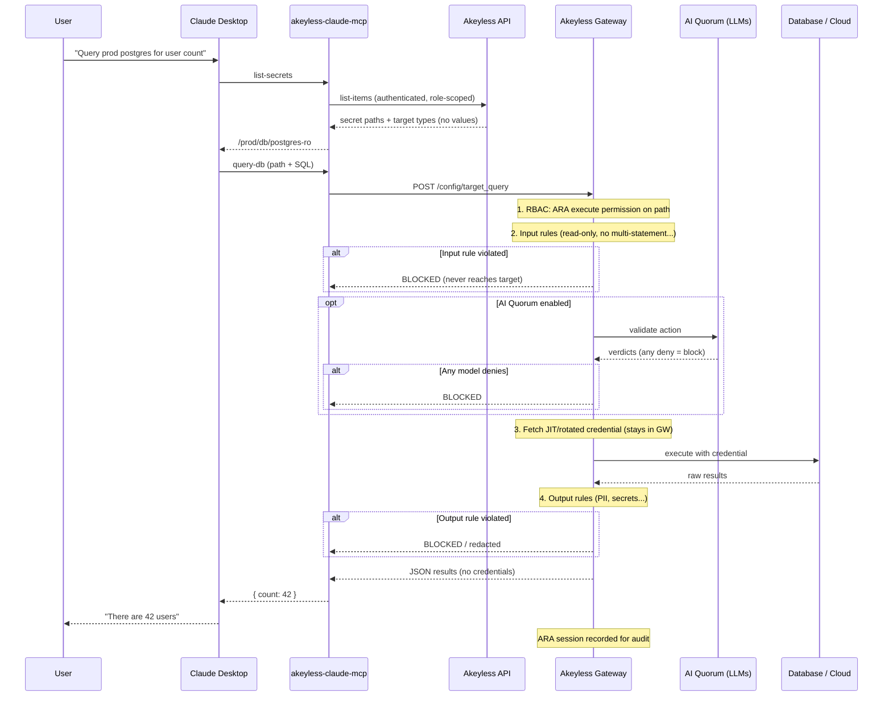

# Akeyless Agentic Runtime Authority for Amazon Bedrock AgentCore

Python library and Model Context Protocol (MCP) server that gives Amazon Bedrock AgentCore agents access to protected resources through [Akeyless Agentic Runtime Authority (ARA)](https://docs.akeyless.io/docs/agentic-runtime-authority). AI agents can query databases, run actions on AWS, Azure, GCP and Kubernetes, and execute commands on Linux (SSH), Windows (WinRM) and LDAP / Active Directory servers, authenticating to the Akeyless Gateway with their AWS IAM role.

AgentCore orchestrates. Akeyless holds the credentials. **Secret values never enter the agent or the model context.**

## Requirements

- Python 3.10+
- Akeyless **Gateway with ARA enabled** (not `api.akeyless.io`)
- Auth method your AgentCore role can use (production: AWS IAM cloud identity)

## Install (local)

```bash
cd bedrock-agentcore-akeyless-rta
python3 -m venv .venv
source .venv/bin/activate
pip install -e ".[mcp,dev]"
```

## Quick start — client

```python
from akeyless_agentcore_rta import AkeylessRtaClient

client = AkeylessRtaClient()  # reads AKEYLESS_* env
for s in client.list_secrets():
    print(s.name, s.target_type)  # never prints credentials

rows = client.query_db("SELECT 1", secret_name="/prod/db/readonly")
print(rows.results)
```

## Quick start — MCP on AgentCore

```bash
# env (required)
export AKEYLESS_GATEWAY_URL=https://gw.example.com:8000
export AKEYLESS_ACCESS_ID=p-xxxxx
export AKEYLESS_ACCESS_TYPE=aws_iam   # or access_key locally

python examples/mcp-server/server.py
# AgentCore: protocol MCP → examples/mcp-server/server.py
```

## Environment

| Variable | Required | Notes |
|----------|----------|-------|
| `AKEYLESS_GATEWAY_URL` | **Yes** | Customer GW (`https://gw:8000` or `…/api/v2`). Public SaaS rejected. |
| `AKEYLESS_ACCESS_ID` | Yes* | Auth method access id |
| `AKEYLESS_ACCESS_TYPE` | No | Default `aws_iam`. Also: `access_key`, `oidc`, `saml`, `jwt`, … |
| `AKEYLESS_ACCESS_KEY` | For access_key | Local/dev only |
| (OIDC/SAML) | — | Browser login to Gateway; needs Access ID only |
| `AKEYLESS_AGENT_ID` | No | Default `bedrock-agentcore` |
| `AKEYLESS_MCP_ID` | No | Default `akeyless-agentcore-rta` |
| `AKEYLESS_DEFAULT_SECRET_NAME` | No | Optional default path for execute tools |

\* Or `AKEYLESS_TOKEN` for a pre-issued session token.

## Architecture



## Docs

| Guide | Description |
|-------|-------------|
| [Akeyless setup](docs/AKEYLESS_SETUP.md) | Auth method, ARA RBAC, chicken-and-egg IAM bind |
| [AgentCore deploy](docs/AGENTCORE_DEPLOY.md) | MCP protocol, envVars, invoke |
| [Security](SECURITY.md) | Checklist |
| [Maintainer guide](docs/MAINTAINER.md) | Branch protection, approvals, PyPI environment |
| [Publishing to PyPI](docs/PYPI_PUBLISHING.md) | Trusted publishing setup |
| [Contributing](CONTRIBUTING.md) | Development setup |

**Repository:** [github.com/akeyless-community/bedrock-agentcore-akeyless-rta](https://github.com/akeyless-community/bedrock-agentcore-akeyless-rta)

## Development

```bash
pip install -e ".[mcp,dev]"
pytest
```

Run pytest **inside this package directory** so the workspace root does not collect unrelated tests.

## Related

- Secrets at runtime (values in agent): [`akeyless-agentcore-runtime`](https://github.com/akeyless-community/bedrock-agentcore-akeyless-runtime)
- Product docs: [Agentic Runtime Authority](https://docs.akeyless.io/docs/agentic-runtime-authority)
