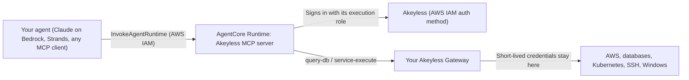

# User guide: Akeyless Agentic Runtime Authority on Amazon Bedrock AgentCore

This guide takes you from nothing to an AI agent on Amazon Bedrock that works with AWS, databases and other systems **without ever holding a credential**. It takes about 30 minutes if you already have an Akeyless Gateway.

## How it works



1. Your agent calls a tool such as `service-execute` on the AgentCore Runtime. AgentCore lets the call through only if the caller's IAM identity may invoke that runtime.
2. The MCP server signs in to Akeyless with the runtime's **execution role**. Its configuration holds no keys or passwords, only a Gateway URL and an Access ID.
3. The **Gateway** checks the request against the secret's **agentic rules**, runs it with short-lived credentials it keeps to itself, applies the output rules, and returns only the results.
4. Every call is written to the **Akeyless audit log** with the agent ID, the original user and the original prompt.

## What you need

| Item | Notes |
|------|-------|
| AWS account with Bedrock AgentCore | And a region where AgentCore Runtime is available |
| AgentCore CLI (`agentcore`) and AWS CLI | Signed in with rights to deploy runtimes |
| Akeyless account and `akeyless` CLI | Rights to create auth methods and roles |
| Akeyless Gateway with Agentic Runtime Authority | Customer or self-hosted, reachable from AgentCore. `https://api.akeyless.io` does **not** work: the SaaS API doesn't host the execute endpoints, and the package rejects it |
| A dynamic or rotated secret | For example an AWS dynamic secret, or a database producer the Gateway can reach |

## Step 1: Set up Akeyless

**Create an AWS IAM auth method.** AgentCore creates the runtime's execution role on the first deploy, so start by binding the account, then narrow it to the role in Step 4:

```bash
akeyless auth-method create aws-iam \
  --name /bedrock-agentcore/rta \
  --bound-aws-account-id 111122223333
```

Save the returned Access ID (`p-…`). It's not a secret, but it is the only Akeyless setting the runtime needs.

**Create a role** that can see your secrets and use them through Agentic Runtime Authority, and attach the auth method:

```bash
akeyless create-role --name bedrock-agentcore-rta
akeyless set-role-rule --role-name bedrock-agentcore-rta \
  --path '/ara/*' --capability read --capability list
akeyless set-role-rule --role-name bedrock-agentcore-rta \
  --path '/ara/*' --capability allow_access --rule-type ara-rule
akeyless assoc-role-am --role-name bedrock-agentcore-rta --am-name /bedrock-agentcore/rta
```

Keep the role narrow. Every caller of the runtime acts with it.

**Turn on Agentic Runtime Authority on the secret and add rules.** Input rules are plain-language checks the Gateway applies before it runs anything. Output rules filter what comes back. These are from the demo, on an AWS dynamic secret scoped to EC2:

```bash
akeyless update-item --name /ara/aws-bedrock-demo --ara-enabled true \
  --input-rule "name=ec2-scope-only,rule=Only allow EC2-related operations. Reject IAM S3 Lambda RDS SecretsManager KMS CloudFormation and non-EC2 services." \
  --input-rule "name=read-only-discovery,rule=Allow read-only EC2 describe/list/get operations on any instance." \
  --input-rule "name=demo-tags-only-mutations,rule=Only allow Start Stop Reboot on instances with BOTH tags Environment=demo AND AgentScope=allowed. Reject Environment=production or AgentScope=denied or DataClassification=confidential." \
  --input-rule "name=no-destructive-ops,rule=Never allow TerminateInstances RunInstances Create* Delete* ModifyInstanceAttribute volume or security-group mutations." \
  --output-rule "name=mask-account-in-arns,rule=Mask AWS account IDs in ARNs replacing the 12-digit account id with ***." \
  --output-rule "name=no-credentials-in-output,rule=Redact access keys secret keys session tokens user-data and passwords from responses."
```

You can also do all of this in the Akeyless Console. Open the secret, enable Agentic Runtime Authority, and add the rules under **Input Rules** and **Output Rules**.

## Step 2: Create the MCP server project

These steps use AgentCore CLI 1.x (`agentcore --version`). Scaffold a minimal Python project:

```bash
agentcore create --name MyRta --template agent-python-minimal
cd MyRta
```

Replace `app/agent/main.py` with a one-line entry point on top of the package:

```python
from akeyless_agentcore_rta.tools.mcp import run_mcp_server

if __name__ == "__main__":
    run_mcp_server()
```

Add the package to `dependencies` in `app/agent/pyproject.toml`:

```text
"akeyless-agentcore-rta[mcp,aws]>=0.3.0",
```

The `aws` extra installs `boto3`, which the AWS IAM sign-in needs. The server listens on `0.0.0.0:8000/mcp` over stateless streamable HTTP, which is what AgentCore's MCP protocol expects.

## Step 3: Deploy to AgentCore

In `agentcore/agentcore.json`, make the runtime an MCP server with IAM-only access, and give it its settings:

```json
{
  "name": "agent",
  "build": "CodeZip",
  "entrypoint": "main.py",
  "codeLocation": "app/agent",
  "runtimeVersion": "PYTHON_3_14",
  "protocol": "MCP",
  "authorizerType": "AWS_IAM",
  "envVars": [
    {"name": "AKEYLESS_GATEWAY_URL", "value": "https://gw.example.com:8000"},
    {"name": "AKEYLESS_ACCESS_ID", "value": "p-xxxxx"},
    {"name": "AKEYLESS_ACCESS_TYPE", "value": "aws_iam"},
    {"name": "AKEYLESS_AGENT_ID", "value": "my-agent"}
  ]
}
```

The settings the server reads:

| Variable | Example | Notes |
|----------|---------|-------|
| `AKEYLESS_GATEWAY_URL` | `https://gw.example.com:8000` | Required. Your Gateway, `https://host:8000` or `…/api/v2` |
| `AKEYLESS_ACCESS_ID` | `p-xxxxx` | Required. From Step 1 |
| `AKEYLESS_ACCESS_TYPE` | `aws_iam` | Default `aws_iam` |
| `AKEYLESS_AGENT_ID` | `my-agent` | Optional. Default agent ID in the audit log (`bedrock-agentcore`) |
| `AKEYLESS_DEFAULT_SECRET_NAME` | `/ara/aws-bedrock-demo` | Optional. Pins the tools to one secret, so callers don't pass `secret-name` |

Then deploy:

```bash
agentcore deploy
agentcore status --json
```

Wait until the runtime shows as `deployed`.

## Step 4: Bind the execution role in Akeyless

Find the runtime's execution role in the deploy output or in the AgentCore console, then narrow the auth method to that role:

```bash
akeyless update-auth-method-aws-iam \
  --name /bedrock-agentcore/rta \
  --bound-aws-account-id 111122223333 \
  --bound-role-name AgentCore-MyProject-ApplicationRuntimeAgentRu-XXXXXXXX
```

Until you do this, anything in the account that can sign in with AWS IAM could use the auth method.

## Step 5: Connect your agent

Callers need IAM permission for `bedrock-agentcore:InvokeAgentRuntime` on the runtime ARN.

**Quick test with the AgentCore CLI:**

```bash
agentcore invoke --runtime agent --json --payload '{
  "jsonrpc": "2.0", "id": 1, "method": "tools/call",
  "params": {"name": "list-secrets", "arguments": {"path": "/ara"}}
}'
```

**From code (boto3).** This is how the demo agent, Claude on Bedrock using the Converse API, calls the tools:

```python
import json
import boto3

RUNTIME_ARN = "arn:aws:bedrock-agentcore:us-east-2:111122223333:runtime/MyProject_agent-XXXXXXXX"
client = boto3.client("bedrock-agentcore", region_name="us-east-2")

def rpc(method, params, _id=[0]):
    _id[0] += 1
    r = client.invoke_agent_runtime(
        agentRuntimeArn=RUNTIME_ARN,
        payload=json.dumps({"jsonrpc": "2.0", "id": _id[0], "method": method, "params": params}).encode(),
        contentType="application/json",
        accept="application/json, text/event-stream",
    )
    raw = r["response"].read().decode()
    if raw.startswith(("event:", "data:")):
        raw = "\n".join(line[5:] for line in raw.splitlines() if line.startswith("data:"))
    return json.loads(raw)["result"]

tools = rpc("tools/list", {})["tools"]   # hand these to your model as tool definitions
result = rpc("tools/call", {"name": "service-execute", "arguments": {
    "secret-name": "/ara/aws-bedrock-demo",
    "payload": "Describe EC2 instances with Name tag akeyless-rta-demo in us-east-2",
    "agent-id": "my-agent",
    "original-user": "alice@example.com",
    "original-prompt": "Show me the demo instance",
}})
```

Keep in mind:
- Argument names are hyphenated (`secret-name`, `agent-id`, `original-user`, `original-prompt`). They match the Akeyless Go MCP server.
- `query-db` and `service-execute` require `payload`, `agent-id`, `original-user` and `original-prompt`, plus `secret-name` unless `AKEYLESS_DEFAULT_SECRET_NAME` is set. Pass the end user's real prompt so the audit log shows what was asked.
- Gateway calls usually take 10 to 40 seconds. Remote commands can take up to 3.5 minutes. Set client timeouts accordingly.

## Step 6: Use it

The agent gets four tools:

| Tool | What it does |
|------|--------------|
| `list-secrets` | Lists the secrets the agent may use: names and types only, never values |
| `query-db` | Runs a SQL or NoSQL query on a database secret. The Gateway returns the rows |
| `service-execute` | Runs an AWS, Azure, GCP, Kubernetes, GitHub or custom MCP action, or a command on an SSH, Windows or LDAP item |
| `list-sub-tools` | Discovers the actions available on a service secret or remote item |

What the demo looked like with the rules above:

| The agent asked | Result |
|-----------------|--------|
| "Show the demo EC2 instance" | **Allowed** by `read-only-discovery`. Real instance details come back, with account IDs masked |
| "List all S3 buckets" | **Denied** by `ec2-scope-only`. Nothing runs |
| "Stop the instance named akeyless-rta-prod-deny" | **Denied** by `demo-tags-only-mutations`: it's tagged `Environment=production` |
| "Give me the AWS access keys" | **Nothing to give.** The agent never holds credentials, and `no-credentials-in-output` redacts them from any response |

Rules judge the text of the request. If a change depends on tags, have the agent describe the instance first, then ask for the change by name or instance ID.

## Step 7: Check the audit log

In the Akeyless Console, open **Logs**. You'll see one entry for each tool call, with the agent ID, the original user, the prompt, the secret used and whether the call was allowed or denied.

## Embedded mode (no MCP server)

If your agent code already runs on AgentCore and you don't need MCP, call the library directly:

```python
from akeyless_agentcore_rta import AkeylessRtaClient

client = AkeylessRtaClient()  # reads AKEYLESS_GATEWAY_URL and AKEYLESS_ACCESS_ID from env
out = client.service_execute("Describe EC2 instances in us-east-2", secret_name="/ara/aws-bedrock-demo")
print(out.results)
```

For local testing against the same Gateway, use an access key instead of AWS IAM: `AKEYLESS_ACCESS_TYPE=access_key` with `AKEYLESS_ACCESS_KEY`. Keep access keys out of AgentCore.

## Troubleshooting

| Symptom | Likely cause and fix |
|---------|---------------------|
| `AccessDeniedException` from `InvokeAgentRuntime` | The caller lacks `bedrock-agentcore:InvokeAgentRuntime` on the runtime ARN |
| Error says to install the `aws` extra | The image is missing `boto3`: depend on `akeyless-agentcore-rta[mcp,aws]` |
| Akeyless sign-in fails after deploy | The auth method isn't bound to the runtime's execution role or account (Step 4) |
| `list-secrets` is empty | The role is missing the `read`/`list` rule or the `ara-rule` / `allow_access` rule, or Agentic Runtime Authority isn't enabled on the secret |
| Timeouts reaching the Gateway | AgentCore can't reach the Gateway on port 8000. Check its address and network path |
| `unsupported secret type` on a remote command | The Gateway is older than 5.6.0 |
| Denial message says "Rule 1" instead of the rule's name | That's how the Gateway reports denials today. Rules are numbered in the order they're listed on the secret |

## Clean up

The AgentCore CLI deploys through a CloudFormation stack (CDK). Delete that stack in the CloudFormation console to remove the runtime and its execution role. Then remove the Akeyless objects:

```bash
akeyless delete-role --name bedrock-agentcore-rta
akeyless delete-auth-method --name /bedrock-agentcore/rta
```
